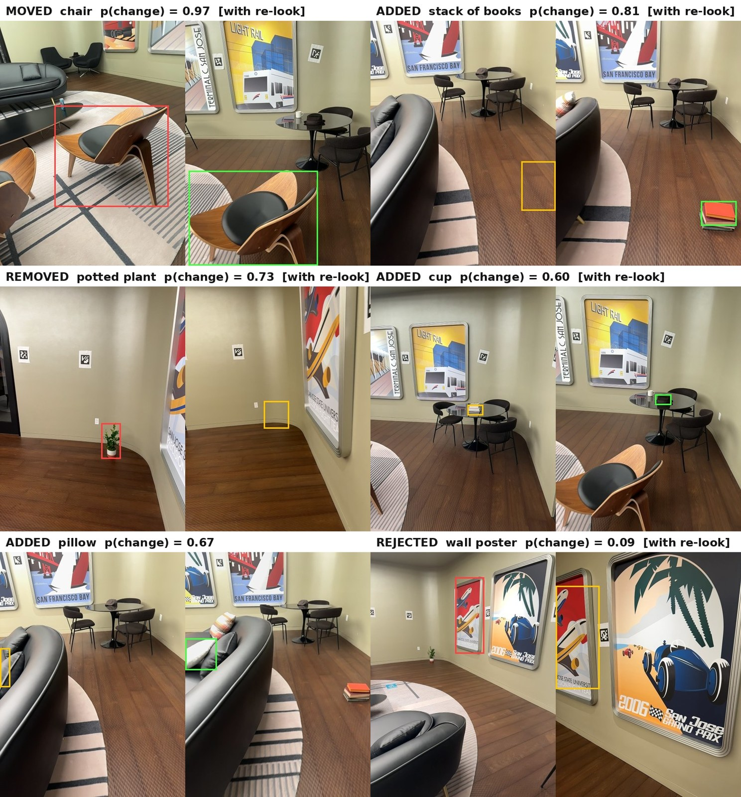

# Revisit

Revisit compares two phone scans of the same room and reports what physically changed: objects that were moved,
added, removed, replaced or swapped, each with a label, a 3D box, a displacement in metres and a calibrated
probability. Proposals the second scan never looked at come back as UNVERIFIED, with a spot to look from, and
an extra scan that covers those places settles them.

**[Report (6 pages, PDF)](report/revisit_report.pdf)** · [Adapters](https://huggingface.co/amitabh3/revisit-verifier-lora) · [Captures](https://huggingface.co/datasets/amitabh3/revisit-room-captures) · [Artifacts](https://huggingface.co/datasets/amitabh3/revisit-artifacts)

<p align="center"></p>

Six proposals from the room benchmark with the Qwen verifier: first scan on the left, second scan or re-look on
the right. Five are reported as changes, two of them with the wrong type (the cup moved and the pillow was
replaced); the poster, which never moved, is rejected.

The test room on video: [Take 1](https://youtu.be/VDI5xJ1UHZw) (before),
[Take 2](https://youtu.be/iZ1sGiMjBXQ) (before, another route), [Take 3](https://youtu.be/vNPY1HJV00I)
(after nine changes), [Take 4](https://youtu.be/2T7ERQ7c4KE) (after, a second walk that also films the
corner Take 3 skipped).

## How it works

1. Pick 28 steady keyframes per scan (lowest gyro rate in each time window), with the LiDAR depth and ARKit
   camera path that Stray Scanner records.
2. Reconstruct all scans together with [Pi3](https://github.com/yyfz/Pi3) and set metric scale from the ARKit path.
3. Propose changed objects with [SceneDiff](https://github.com/yuqunw/scene_diff)'s method: SAM 2.1 masks,
   DINOv3 features and geometric cost maps.
4. Mark proposals the second scan never looked at as UNVERIFIED, and test for replaced and swapped objects.
5. Show each proposal to an 8B vision-language model trained with GDPO + RLCR. It accepts or rejects the
   proposal and names the object; a fixed rule combines its answer with the base model's answer and the 3D
   scores into the final verdict and p(change).

## Results

### Room benchmark

Four scans of one room, nine staged changes and look-alike objects that never moved
([details](docs/room_benchmark.md)). Every report was checked by hand against the staged changes. Right: the
right object and verdict type. Partly right: the right object with the wrong type, the wrong destination or
only half of a swap.

| Verifier | No-change pair: false changes | Before/after: right + partly right | With re-look: right + partly right | With re-look: false reports |
|:--|--:|--:|--:|--:|
| Qwen3-VL-8B + GDPO+RLCR | 11 of 17 proposals | 2 + 4 | 4 + 3 | 6 |
| SenseNova-SI-8B + GDPO+RLCR | 10 of 17 proposals | 3 + 4 | 5 + 3 | 7 |

Before the re-look, the flat item on the rug is UNVERIFIED; the re-look reports it and the plant in the skipped
corner as removed. The plant itself gets no proposal before the re-look, so it is never UNVERIFIED. Per-change
results are in [room_benchmark.md](docs/room_benchmark.md#per-change-audit).

### SceneDiff test split

249 scenes, 2,231 proposals. Every row filters the same Pi3 + DINOv3 + SAM 1 proposals.

| Verifier | px/im IoU | obj/im AP | obj/sc AP | AUROC | 4-way acc. | Brier | ECE |
|:--|--:|--:|--:|--:|--:|--:|--:|
| none (proposals only) | 30.0 | 33.5 | 17.6 | 0.810 | - | 0.253 | 0.379 |
| Qwen3-VL-8B, zero-shot | 34.5 | 33.4 | 21.0 | 0.734 | 56.0 | 0.376 | 0.377 |
| SenseNova-SI-8B, zero-shot | 34.8 | 34.1 | 22.4 | 0.772 | 62.1 | 0.323 | 0.321 |
| Qwen3-VL-8B + GRPO | 38.1 | 34.9 | 22.5 | 0.861 | 64.3 | 0.210 | 0.328 |
| Qwen3-VL-8B + GDPO | 39.6 | 34.6 | 22.6 | 0.862 | 69.1 | 0.152 | 0.224 |
| Qwen3-VL-8B + GDPO+RLCR | 40.5 | 34.2 | 22.5 | 0.862 | 71.1 | 0.102 | 0.066 |

The RL adapters here were trained for 45 steps on validation scenes; pruning and fusion constants were also set
on validation. One comparison in the room takes 9 to 13 minutes on one H100
([runtime by stage](docs/reproducing.md#runtime)).

## Setup

Linux with an NVIDIA GPU, Python 3.10 and CUDA 12.1 (tested on H100 80GB). One comparison peaks at 39 GB of
GPU memory and 85 GB of RAM (53 GB and 126 GB with a re-look scan).

```bash
conda create -n revisit python=3.10 -y && conda activate revisit
pip install torch==2.5.1 torchvision==0.20.1 --index-url https://download.pytorch.org/whl/cu121
pip install -U pip setuptools wheel
SAM2_BUILD_CUDA=0 pip install --no-build-isolation -e . -f https://data.pyg.org/whl/torch-2.5.1+cu121.html
```

Models and data go into `checkpoints/` and `data/` inside the repository (or set `REVISIT_CKPT_DIR` and
`REVISIT_DATA_DIR`). DINOv3 is gated: accept its license on Hugging Face, then log in.

```bash
hf auth login
python scripts/download_checkpoints.py --set room      # Pi3, DINOv3, SAM 2.1, both VLMs, our adapters (~42 GB)
python scripts/download_data.py --room                 # our four captures (0.9 GB)
```

```
checkpoints/yyfz233/Pi3/                                   data/room/Take_1 ... Take_4/
checkpoints/facebook/dinov3-vith16plus-pretrain-lvd1689m/  data/scenediff/scenediff_benchmark/   (--scenediff)
checkpoints/facebook/sam2.1-hiera-large/                   data/artifacts/                       (--artifacts)
checkpoints/Qwen/Qwen3-VL-8B-Instruct/
checkpoints/sensenova/SenseNova-SI-1.3-Qwen3-VL-8B/
checkpoints/revisit-verifier-lora/<adapter>/
```

Other sets are `scenediff`, `ablation`, `train` and `all`; `--list` prints every source and destination.
Our adapters, captures and artifacts are on Hugging Face:
[amitabh3/revisit-verifier-lora](https://huggingface.co/amitabh3/revisit-verifier-lora),
[amitabh3/revisit-room-captures](https://huggingface.co/datasets/amitabh3/revisit-room-captures) and
[amitabh3/revisit-artifacts](https://huggingface.co/datasets/amitabh3/revisit-artifacts).
The download scripts find them through `hf_org` in `configs/checkpoints.yaml`.

## Run it

```bash
python scripts/run_room.py --before data/room/Take_1 --after data/room/Take_3 --relook data/room/Take_4
rerun outputs/room/Take_1_vs_Take_3_relook_Take_4/scene_diff.rrd
```

Add `--verifier sensenova` for the other verifier. The report is `change_report.md` in the same folder.
To scan your own room, see [docs/capture.md](docs/capture.md).

## Example output

Input: `data/room/Take_1` (before) and `data/room/Take_3` (after). Four of the 19 rows of
[change_report.md](results/room/qwen/Take_1_vs_Take_3/change_report.md):

| ID | Verdict | Object | p(change) | Displacement (m) | Verifier summary or look-from pose |
|---:|:---|:---|---:|---:|:---|
| `6` | **MOVED** | `chair` | `0.966` | `0.827` | Verified moved chair across multi-view 3D registration (mean_cost=1.07, max_cost=1.36, render_diff=0.66, delta_3d=0.827m, vis_coverage=0.86). |
| `17` | **ADDED** | `stack of books` | `0.786` | `0.000` | Verified added stack of books across multi-view 3D registration (mean_cost=0.80, max_cost=0.80, render_diff=0.75, delta_3d=0.000m, vis_coverage=0.89). |
| `12` | **UNVERIFIED** | `book` | `0.714` | `0.000` | Not seen in scan 2 (`frustum_ratio=0.04`). Look from `pos=[-2.371, 0.771, -0.385]m` toward `target=[-1.884, 1.298, 0.07]m`, `yaw=47.0°`. |
| `8` | **MOVED** | `chair` | `0.913` | `6.811` | Verified moved chair across multi-view 3D registration (mean_cost=0.89, max_cost=1.25, render_diff=0.74, delta_3d=6.811m, vis_coverage=0.86). |

Rows 6 and 17 are right: a twin chair pulled back 0.83 m and a new stack of books. Row 12 is a flat item the
second scan barely saw, so Revisit asks for a look instead of guessing. Row 8 is wrong: a chair matched to an
identical one 6.8 m away.

## Reproduce

| Result | Command | Time |
|:--|:--|:--|
| Room benchmark | `bash reproduce/room.sh` | ~25 min on 3 GPUs |
| SceneDiff table | `bash reproduce/scenediff.sh [metrics\|verify\|full]` | minutes on CPU to ~3 h on 8 GPUs |
| Mask backend and keyframes | `bash reproduce/mask_ablation.sh` | ~2.5 h on 3 GPUs |
| Metric scale, runtime | `bash reproduce/metric_scale.sh`, `bash reproduce/runtime.sh` | ~75 min on 3 GPUs |

Each script compares its output with `results/`. Details: [docs/reproducing.md](docs/reproducing.md).

## Train a verifier

```bash
python scripts/download_checkpoints.py --set train && python scripts/download_data.py --scenediff --artifacts
bash reproduce/train_verifier.sh configs/train/qwen3vl8b_gdpo_rlcr_step45.yaml
```

Training runs on one machine with 8 GPUs (`torchrun`) and takes about 8 minutes for the 45-step SceneDiff
recipes and about 3 days for the room recipes. See [docs/training.md](docs/training.md).
The released room adapters were trained on six 8-GPU machines; that launcher is not included, and the
single-machine room configs see the same number of cards with the same learning-rate schedule.

## Design choices

Three decisions shape Revisit; the [report](report/revisit_report.pdf) has the reasoning and the ablations.

- **Propose, then verify.** A geometric proposer on one joint reconstruction of all scans keeps recall high;
  two checks decide what gets reported.
- **Unseen is not removed.** Objects the second scan never looked at come back UNVERIFIED, with a pose to
  look from, instead of being guessed.
- **A verifier that returns a probability.** An 8B vision-language model trained with GDPO and a calibration
  reward gives p(change), so the system can decide when another look is worth it.

## Limitations

- It over-reports: on two scans of an unchanged room, 10 to 11 of 17 proposals still come back as changes.
- Identical objects get confused (the 6.6 to 6.8 m "moves"), and an object in a spot the second scan never
  filmed may get no proposal at all.
- One room, one phone, and settings chosen on that room. The [report](report/revisit_report.pdf) goes through
  each failure.

The four captures, the pipeline, two RL runs on 96 GPUs and the report came together in two days, so read the
numbers as a working design rather than a finished product.

## Licenses and acknowledgements

Our code is MIT. `revisit/proposals/` adapts [SceneDiff](https://github.com/yuqunw/scene_diff) (MIT; changes in
[MODIFICATIONS.md](revisit/proposals/MODIFICATIONS.md)) and vendors a mask generator derived from Segment
Anything (Apache-2.0). Models keep their own licenses: Pi3 (BSD), SAM 2.1 (Apache-2.0), DINOv3 (DINOv3 License),
Qwen3-VL-8B and SenseNova-SI-1.3 (Apache-2.0), SAM 3.1 (SAM License, ablation only). The RL recipe combines
[GDPO](https://arxiv.org/abs/2601.05242) and [RLCR](https://arxiv.org/abs/2507.16806).

```bibtex
@misc{revisit2026,
  title  = {Revisit: Did It Change, or Did We Just Not Look?},
  author = {Amitabh Mahapatra},
  year   = {2026},
  note   = {https://github.com/amitabhm1/revisit}
}
```
